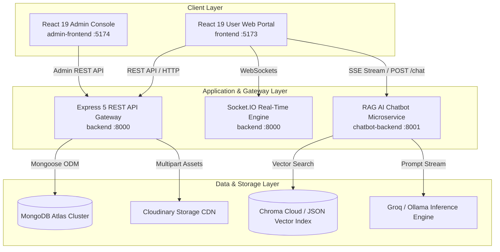
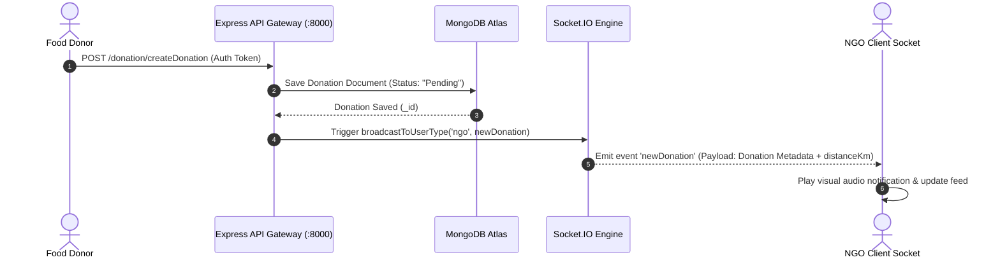
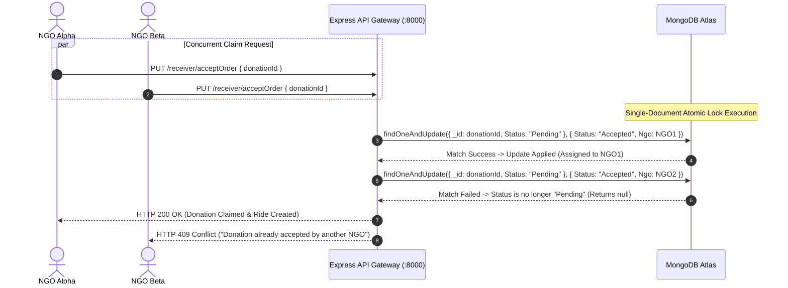
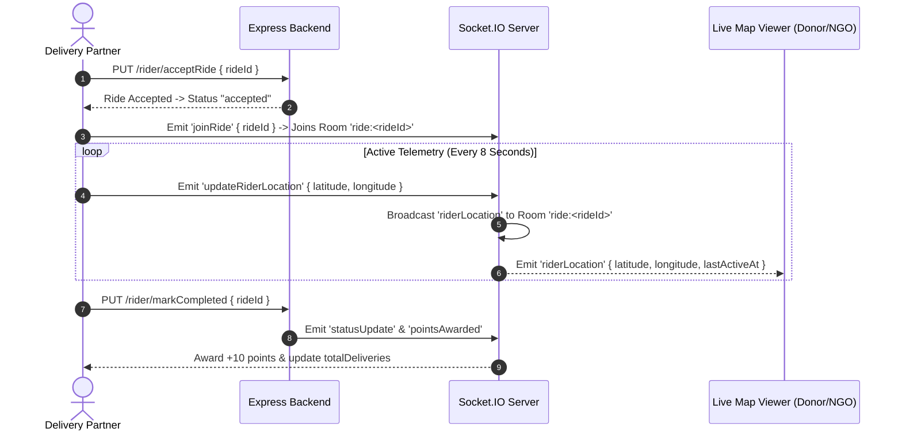
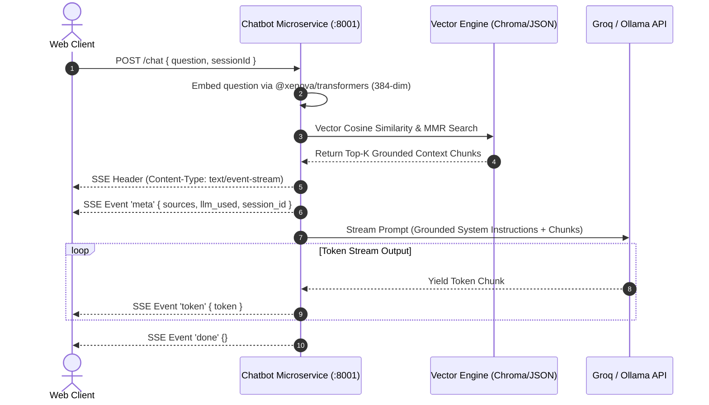

# 🌿 Sahaaya (सहाय्य) — Enterprise Real-Time Food Surplus Redistribution & AI Logistics Ecosystem

[](https://github.com/)
[](https://react.dev/)
[](https://expressjs.com/)
[](https://www.mongodb.com/)
[](https://socket.io/)
[](https://huggingface.co/docs/transformers.js/index)
[](#license)

> **Official Comprehensive Technical Documentation & Architectural Blueprint**  
> **Target System**: Sahaaya Production Platform  
> **Ecosystem Version**: 2.0.0 (Production Release)  

---

## 📋 Table of Contents

- [1. Executive Summary & Problem Statement](#1-executive-summary--problem-statement)
- [2. System Architecture & Ecosystem Topology](#2-system-architecture--ecosystem-topology)
- [3. Complete Repository Map](#3-complete-repository-map)
- [4. Visual Mermaid Sequence Diagrams](#4-visual-mermaid-sequence-diagrams)
- [5. Sub-Application Deep Dive](#5-sub-application-deep-dive)
  - [5.1 User Web Application (`frontend/`)](#51-user-web-application-frontend)
  - [5.2 Core REST API & WebSockets (`backend/`)](#52-core-rest-api--websockets-backend)
  - [5.3 RAG AI Assistant Microservice (`chatbot-backend/`)](#53-rag-ai-assistant-microservice-chatbot-backend)
  - [5.4 Administrative Console (`admin-frontend/`)](#54-administrative-console-admin-frontend)
- [6. Master Environment Variables Matrix](#6-master-environment-variables-matrix)
- [7. Unified Local Development & Quickstart](#7-unified-local-development--quickstart)
- [8. Production Deployment Strategy](#8-production-deployment-strategy)
- [9. Security, Concurrency & Reliability Hardening](#9-security-concurrency--reliability-hardening)
- [10. License & Project Maintainers](#10-license--project-maintainers)

---

## 1. Executive Summary & Problem Statement

### 1.1 Current Industry Problem
According to the United Nations Environment Programme (UNEP) Food Waste Index, over **1.05 billion tonnes of edible food** is wasted globally each year, while over **780 million people** suffer from chronic hunger. In urban centers, commercial food establishments (restaurants, event venues, corporate cafeterias, supermarkets) generate substantial volumes of high-quality cooked surplus food daily.

However, this surplus food is discarded due to three structural bottlenecks:
1. **Logistical Disconnection**: Donors lack direct, low-latency communication channels with certified non-governmental organizations (NGOs) and food shelters.
2. **Time Sensitivity & Perishability**: Cooked meals have a narrow safety window (typically 3 to 6 hours). Without immediate notification and dynamic dispatch, food spoils before collection.
3. **Double-Claiming & Race Conditions**: Uncoordinated distribution channels lead to multiple entities attempting to collect the same food, resulting in fuel waste and logistical failure.

### 1.2 The Sahaaya Solution
**Sahaaya** (*Sanskrit for Support / Succor*) is an integrated, real-time logistics engine and AI assistant platform designed to automate urban food redistribution:
- **Sub-100ms Push Alerts**: Notifies nearby verified NGOs immediately via Socket.IO WebSocket rooms when food is posted.
- **Atomic Concurrency Control**: Employs single-document MongoDB atomic locks (`findOneAndUpdate({ _id, Status: "Pending" })`) to guarantee zero double-claiming.
- **Geofenced Rider Logistics**: Calculates great-circle Haversine distances to match delivery partners within a 20km radius.
- **Live 8-Second GPS Telemetry**: Relays real-time coordinate updates smooth-interpolated on Google Maps.
- **In-House Local RAG AI**: Runs a zero-cost local neural embedding engine (`all-MiniLM-L6-v2` ONNX pipeline) providing grounded answers via SSE token streaming.

---

## 2. System Architecture & Ecosystem Topology

The Sahaaya platform is structured into four decoupled micro-applications communicating over REST, WebSockets, and Server-Sent Events:



---

## 3. Complete Repository Map

```
Sahaaya/
├── admin-frontend/             # Administrative Management Console (React 19 + Vite)
│   ├── src/                    # Admin components, context & pages
│   ├── package.json            # Admin dependencies
│   └── README.md               # 📄 Admin Frontend Technical Documentation
├── backend/                    # Core REST API & Socket.IO Web Server (Express 5 + Mongoose 8)
│   ├── src/
│   │   ├── controller/         # 11 Business Logic Controllers
│   │   ├── db/                 # MongoDB Mongoose Connection Initialization
│   │   ├── middleware/         # Auth, AdminAuth, Multer & Rate Limiter Middlewares
│   │   ├── model/              # 8 Mongoose Database Schemas
│   │   ├── route/              # 11 Express Router Definition Files
│   │   ├── utils/              # Haversine spatial math, Cloudinary, ApiError helpers
│   │   ├── app.js              # Express App setup (Helmet, CORS, Parsers)
│   │   ├── index.js            # Node HTTP & Socket.IO server startup
│   │   └── socket.js           # WebSocket connection manager & room handler
│   ├── package.json            # Core Backend dependencies
│   └── README.md               # 📄 Core Backend Technical Documentation
├── chatbot-backend/            # Standalone Local RAG Microservice (Node.js)
│   ├── data/                   # Persistent vector storage (vectors.json)
│   ├── knowledge-base/         # Domain knowledge documents (.txt)
│   ├── src/                    # ONNX pipeline, vector stores (Chroma/JSON), LLM drivers
│   ├── package.json            # Chatbot dependencies
│   ├── README.md               # 📄 RAG Chatbot Technical Documentation
│   └── README_OLD.md           # Archived legacy documentation
├── frontend/                   # Main User Web Application (React 19 + Vite + Tailwind 4)
│   ├── src/
│   │   ├── components/         # UI components (ActiveDelivery, ChatPanel, Impact, etc.)
│   │   ├── context/            # AppContext (Auth) & SocketContext (WebSockets)
│   │   ├── pages/              # 13 Multi-role page views (Donor/NGO/Rider/Partner/Track)
│   │   ├── utils/              # Maps loader & Haversine distance calculator
│   │   └── index.css           # Custom Tailwind styling & design tokens
│   ├── package.json            # Frontend dependencies
│   └── README.md               # 📄 Main Frontend Technical Documentation
├── readmefinal.md              # Project status tracking & audit log
├── final1.md                   # System workflow backup documentation
└── README.md                   # 📄 Master Ecosystem Architecture & System Blueprint
```

---

## 4. Visual Mermaid Sequence Diagrams

### 4.1 Donation Creation & Real-Time NGO Push Broadcast



---

### 4.2 Atomic Concurrency Lock for Donation Claims



---

### 4.3 Rider Acceptance & Live GPS Telemetry Stream



---

### 4.4 In-House RAG Query & SSE Token Streaming Flow



---

## 5. Sub-Application Deep Dive

| Directory | Core Role | Tech Stack | Documentation Link |
|---|---|---|---|
| [`frontend/`](file:///c:/Projects/Sahaaya/frontend) | Main User Web Portal for Donors, NGOs, Riders, and Partners | React 19, Vite, Tailwind CSS 4, Socket.IO Client, Google Maps | [frontend/README.md](file:///c:/Projects/Sahaaya/frontend/README.md) |
| [`backend/`](file:///c:/Projects/Sahaaya/backend) | Central REST API Gateway, WebSocket Server & Database Layer | Node.js, Express 5, MongoDB Atlas, Mongoose 8, Socket.IO 4 | [backend/README.md](file:///c:/Projects/Sahaaya/backend/README.md) |
| [`chatbot-backend/`](file:///c:/Projects/Sahaaya/chatbot-backend) | In-House Standalone Local RAG AI Microservice | Node.js, Express, ONNX Transformers, Chroma Cloud / JSON, SSE | [chatbot-backend/README.md](file:///c:/Projects/Sahaaya/chatbot-backend/README.md) |
| [`admin-frontend/`](file:///c:/Projects/Sahaaya/admin-frontend) | System Moderator & Administrative Governance Dashboard | React 19, Vite, Tailwind CSS 4, React Router DOM | [admin-frontend/README.md](file:///c:/Projects/Sahaaya/admin-frontend/README.md) |

---

## 6. Master Environment Variables Matrix

Consolidated reference across all 4 system applications:

```env
# ==============================================================================
# 1. CORE BACKEND SERVICE (.env in backend/)
# ==============================================================================
PORT=8000
MONGODB_URI=mongodb+srv://<user>:<password>@cluster0.mongodb.net/sahaaya
refreshtoken=your_super_secret_jwt_key_here
refreshtime=7d

ADMIN_EMAIL=admin@sahaaya.org
ADMIN_PASSWORD=SuperAdminPassword123!
ADMIN_JWT_SECRET=your_admin_jwt_secret_here

CLOUDINARY_CLOUD_NAME=your_cloudinary_name
CLOUDINARY_API_KEY=your_cloudinary_api_key
CLOUDINARY_API_SECRET=your_cloudinary_api_secret

FRONTEND_URL=http://localhost:5173,http://localhost:5174

email_user=your_email@gmail.com
email_pass=your_gmail_app_password
email_host=smtp.gmail.com
email_port=587
email_from=Sahaaya Platform <noreply@sahaaya.org>

# ==============================================================================
# 2. CHATBOT RAG SERVICE (.env in chatbot-backend/)
# ==============================================================================
PORT=8001
LLM_PROVIDER=groq
GROQ_API_KEY=gsk_your_groq_api_key_here
GROQ_MODEL=llama-3.3-70b-versatile

OLLAMA_URL=http://localhost:11434
OLLAMA_MODEL=mistral

VECTOR_STORE=json
CHROMA_URL=https://api.trychroma.com
CHROMA_API_KEY=your_chroma_api_key

MAIN_BACKEND_URL=http://localhost:8000
CORS_ORIGIN=http://localhost:5173

# ==============================================================================
# 3. USER FRONTEND PORTAL (.env in frontend/)
# ==============================================================================
VITE_BACKEND_URL=http://localhost:8000
VITE_CHATBOT_API_URL=http://localhost:8001
VITE_GOOGLE_MAPS_API_KEY=AIzaSyYourGoogleMapsApiKeyHere

# ==============================================================================
# 4. ADMIN CONSOLE (.env in admin-frontend/)
# ==============================================================================
VITE_BACKEND_URL=http://localhost:8000
```

---

## 7. Unified Local Development & Quickstart

### Step 1: Clone Repository
```bash
git clone https://github.com/your-username/Sahaaya.git
cd Sahaaya
```

### Step 2: Install Dependencies Across All Applications
```bash
# 1. Core Backend
cd backend && npm install && cd ..

# 2. Chatbot Backend
cd chatbot-backend && npm install && cd ..

# 3. User Frontend
cd frontend && npm install && cd ..

# 4. Admin Frontend
cd admin-frontend && npm install && cd ..
```

### Step 3: Launch Local Development Servers

Open 4 separate terminal windows:

```bash
# Terminal 1: Core Backend (Port 8000)
cd backend && npm run dev

# Terminal 2: RAG Chatbot Microservice (Port 8001)
cd chatbot-backend && npm start

# Terminal 3: User Web Application (Port 5173)
cd frontend && npm run dev

# Terminal 4: Admin Console (Port 5174)
cd admin-frontend && npm run dev
```

#### Verification Endpoints
- **User Web Application**: `http://localhost:5173`
- **Admin Console**: `http://localhost:5174`
- **REST API Health**: `http://localhost:8000/healthcheck`
- **Chatbot Health**: `http://localhost:8001/`

---

## 8. Production Deployment Strategy

```
                                  ┌───────────────────────────┐
                                  │ Nginx Reverse Proxy / SSL │
                                  └─────────────┬─────────────┘
                                                │
                 ┌──────────────────────────────┼──────────────────────────────┐
                 ▼                              ▼                              ▼
     ┌───────────────────────┐      ┌───────────────────────┐      ┌───────────────────────┐
     │ Static Web Hosting    │      │ Express API Node      │      │ RAG Microservice Node │
     │ (Vercel / Cloudflare) │      │ (Render / AWS ECS)    │      │ (Render / AWS ECS)    │
     │  frontend & admin-fe  │      │  backend (:8000)      │      │ chatbot-backend(:8001)│
     └───────────────────────┘      └───────────┬───────────┘      └───────────┬───────────┘
                                                │                              │
                                                ▼                              ▼
                                    ┌───────────────────────┐      ┌───────────────────────┐
                                    │ MongoDB Atlas Cluster │      │ Chroma Cloud DB / JSON│
                                    └───────────────────────┘      └───────────────────────┘
```

---

## 9. Security, Concurrency & Reliability Hardening

1. **Atomic Concurrency Protection**: Single-document `findOneAndUpdate` guarantees zero double-claims during high-concurrency NGO claim bursts.
2. **Geospatial Haversine Filter**: Limits rider ride lists to a 20km radius to maximize delivery speed and reduce transit fuel consumption.
3. **Helmet HTTP Hardening**: Strict headers protecting against XSS, clickjacking, and MIME sniffing attacks.
4. **Rate-Limiting Defense**: Protects authentication endpoints against brute-force password guessing (10 attempts / 15 mins).
5. **SSE Abort Controller**: Instantly terminates active LLM completion loops when users close the floating chat drawer.

---