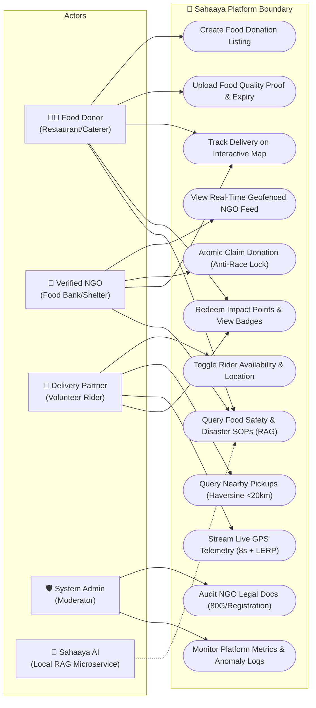
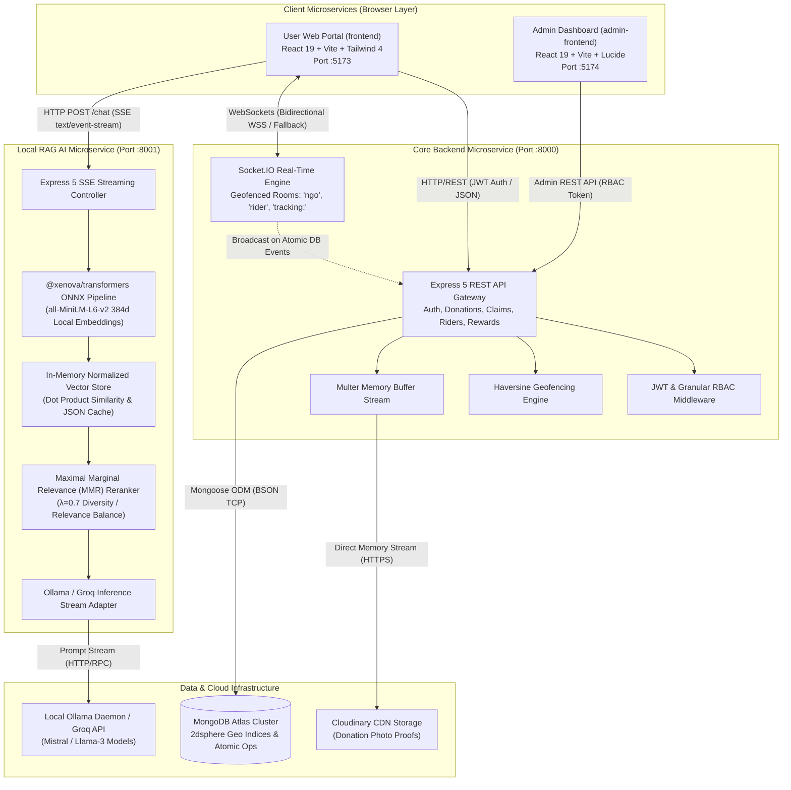
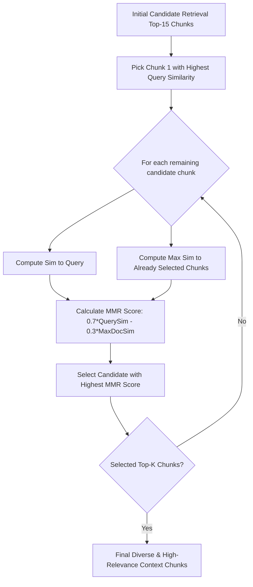
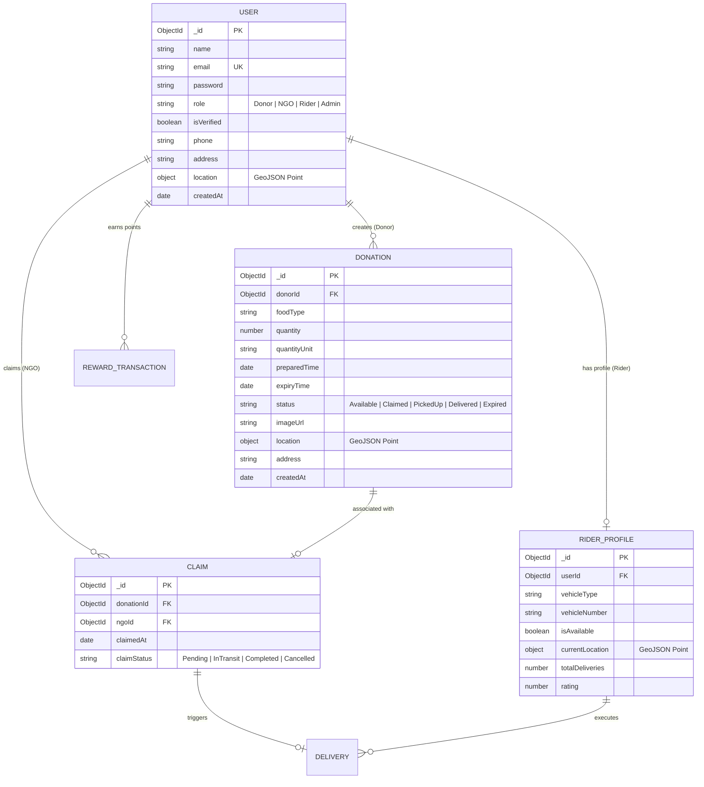

# 🌿 Sahaaya (सहाय्य) — Enterprise Real-Time Food Redistribution, Logistics Engine & Local RAG AI System

[](https://github.com/)
[](https://react.dev/)
[](https://expressjs.com/)
[](https://www.mongodb.com/)
[](https://socket.io/)
[](https://huggingface.co/docs/transformers.js/index)
[](#license)

> **The Ultimate Single-Source Master Guide & Technical Interview Revision Blueprint**  
> **Target Audience**: Full-Stack / GenAI / System Design Interviewers, Architects, & Engineering Candidates  
> **Platform Version**: 2.0.0 (Production Release)  

---

## 📑 Master Table of Contents

1. [Executive Summary & Problem Statement](#1-executive-summary--problem-statement)
2. [Ecosystem Use Case Diagram](#2-ecosystem-use-case-diagram)
3. [Distributed Microservices Architecture & Communication Topology](#3-distributed-microservices-architecture--communication-topology)
4. [Technology Stack Matrix & Architectural Justifications](#4-technology-stack-matrix--architectural-justifications)
5. [Complete Repository Directory Breakdown](#5-complete-repository-directory-breakdown)
6. [Explicit Deep Dive into Sahaaya's Core Features](#6-explicit-deep-dive-into-sahaayas-core-features)
   - [6.1 Feature 1: Real-Time Surplus Food Donation & Lifecycle Management](#61-feature-1-real-time-surplus-food-donation--lifecycle-management)
   - [6.2 Feature 2: Sub-50ms WebSocket Broadcast & Geofenced Distribution](#62-feature-2-sub-50ms-websocket-broadcast--geofenced-distribution)
   - [6.3 Feature 3: Atomic Concurrency & Zero Double-Claiming Engine](#63-feature-3-atomic-concurrency--zero-double-claiming-engine)
   - [6.4 Feature 4: Spherical Haversine Geofencing & 20km Radius Volunteer Dispatch](#64-feature-4-spherical-haversine-geofencing--20km-radius-volunteer-dispatch)
   - [6.5 Feature 5: Real-Time 8-Second Telemetry & 60 FPS RAF LERP Map Tracking](#65-feature-5-real-time-8-second-telemetry--60-fps-raf-lerp-map-tracking)
   - [6.6 Feature 6: In-Memory Local RAG AI Assistant with ONNX WebAssembly & MMR Reranking](#66-feature-6-in-memory-local-rag-ai-assistant-with-onnx-webassembly--mmr-reranking)
   - [6.7 Feature 7: Administrative Governance, NGO Legal Verification & Platform Anomaly Auditing](#67-feature-7-administrative-governance-ngo-legal-verification--platform-anomaly-auditing)
   - [6.8 Feature 8: Impact Points, Leaderboards, Gamified Badges & Reward Economy](#68-feature-8-impact-points-leaderboards-gamified-badges--reward-economy)
   - [6.9 Feature 9: Multi-Role Granular RBAC & Security Perimeter](#69-feature-9-multi-role-granular-rbac--security-perimeter)
   - [6.10 Feature 10: Disaster Management & Emergency Food Relief Protocol](#610-feature-10-disaster-management--emergency-food-relief-protocol)
7. [The Definitive RAG (Retrieval-Augmented Generation) Masterclass](#7-the-definitive-rag-retrieval-augmented-generation-masterclass)
   - [7.1 What is RAG & Why Was It Invented?](#71-what-is-rag--why-was-it-invented)
   - [7.2 RAG vs. Fine-Tuning vs. Prompt Engineering vs. Long Context](#72-rag-vs-fine-tuning-vs-prompt-engineering-vs-long-context)
   - [7.3 The Complete RAG Lifecycle (Ingestion $\rightarrow$ Retrieval $\rightarrow$ Generation)](#73-the-complete-rag-lifecycle)
   - [7.4 Document Chunking Strategies Deep Dive](#74-document-chunking-strategies-deep-dive)
   - [7.5 Vector Embeddings & High-Dimensional Vector Math](#75-vector-embeddings--high-dimensional-vector-math)
   - [7.6 Vector Databases & Indexing Algorithms (HNSW, IVF, Flat)](#76-vector-databases--indexing-algorithms)
   - [7.7 Retrieval & Reranking (Dense, Sparse BM25, Hybrid, Cross-Encoders, MMR)](#77-retrieval--reranking)
   - [7.8 Sahaaya's Zero-Cloud RAG Architecture & Implementation Rationale](#78-sahaayas-zero-cloud-rag-architecture--implementation-rationale)
   - [7.9 Evaluation Frameworks & Hallucination Mitigation (RAGAS)](#79-evaluation-frameworks--hallucination-mitigation-ragas)
8. [Database Architecture & Mongoose Data Models](#8-database-architecture--mongoose-data-models)
9. [Comprehensive REST API Reference & WebSocket Event Protocol](#9-comprehensive-rest-api-reference--websocket-event-protocol)
10. [Sub-Application Deep Dives](#10-sub-application-deep-dives)
    - [10.1 User Client Application (`frontend/`)](#101-user-client-application-frontend)
    - [10.2 Administrative Console (`admin-frontend/`)](#102-administrative-console-admin-frontend)
    - [10.3 Core Express REST & WebSocket Server (`backend/`)](#103-core-express-rest--websocket-server-backend)
    - [10.4 Local RAG Microservice (`chatbot-backend/`)](#104-local-rag-microservice-chatbot-backend)

---

## 1. Executive Summary & Problem Statement

### 1.1 The Real-World Urban Crisis
According to the United Nations Environment Programme (UNEP) Food Waste Index, more than **1.05 billion tonnes of edible food** is wasted globally each year, while over **780 million people** suffer from chronic food insecurity. In metropolitan centers, commercial food providers (restaurants, banquet halls, corporate dining halls, grocery chains, bakeries) generate massive daily surpluses of freshly cooked meals.

Despite goodwill, this food is discarded due to three critical engineering & logistical bottlenecks:
1. **Logistical Disconnection & Latency**: Donors have no programmatic, sub-second communication channels with verified local non-governmental organizations (NGOs) and food banks.
2. **Perishability & The 4-Hour Safety Window**: Hot cooked meals spoil rapidly. Without instant automated broadcast and automated geofenced rider assignment, food reaches unsafe bacterial thresholds before pickup.
3. **Double-Claiming Race Conditions**: When broadcast across uncoordinated channels (e.g., WhatsApp groups or naive SQL/NoSQL updates), multiple NGOs dispatch vehicles for the same single donation, leading to wasted fuel, driver frustration, and logistical collapse.

```
       ┌───────────────────────────────┐
       │   Urban Food Waste Crisis     │
       └──────────────┬────────────────┘
                      │
        ┌─────────────┴─────────────┐
        ▼                           ▼
┌───────────────────┐       ┌───────────────────┐
│ 1.05B Tonnes/Year │       │  780M Malnourished│
│ Food Discarded    │       │  Global Citizens  │
└───────────────────┘       └───────────────────┘
        │                           │
        └─────────────┬─────────────┘
                      ▼
┌───────────────────────────────────────────────┐
│       Bottlenecks in Existing Systems         │
├───────────────────────────────────────────────┤
│ 1. High-Latency Notification Channels         │
│ 2. Narrow 3-6 Hour Perishability Window       │
│ 3. Database Race Conditions & Double-Claiming │
│ 4. Unoptimized Volunteer / Rider Routing      │
└───────────────────────────────────────────────┘
```

### 1.2 The Sahaaya Engineering Solution
**Sahaaya** (*Sanskrit for "Support, Assistance & Succor"*) is a distributed, high-performance web platform and AI-driven logistics ecosystem designed to automate zero-waste food recovery:
- **Instant WebSocket Broadcast (<50ms)**: Pushes new food listings directly to active NGO rooms within the geographic cluster.
- **Atomic MongoDB Isolation**: Employs single-document atomic operations (`findOneAndUpdate` with state preconditions) to guarantee mathematical immunity against double-claiming.
- **Geospatial Logistics & Haversine Geofencing**: Computes great-circle spherical trigonometry to dispatch verified delivery riders located strictly within a 20km operational radius.
- **Real-Time 8-Second Telemetry**: Streams rider GPS coordinates over WebSockets with `requestAnimationFrame` interpolation for buttery smooth map tracking.
- **Zero-Cloud-Cost Local RAG AI**: Runs a complete neural embedding model (`all-MiniLM-L6-v2` via ONNX WebAssembly) locally inside Node.js memory, paired with Maximal Marginal Relevance (MMR) reranking and Server-Sent Events (SSE) token streaming.

---

## 2. Ecosystem Use Case Diagram

The following Use Case Diagram illustrates how each distinct actor interacts with the Sahaaya platform boundary:



---

## 3. Distributed Microservices Architecture & Communication Topology

Sahaaya is engineered using a decoupled, multi-tier microservices architecture where each service has a dedicated runtime, port, communication protocol, and data boundary:



### Microservices Communication Protocol Breakdown

| Microservice | Port | Primary Protocol | Data Format | Target / Destination | Purpose |
|---|---|---|---|---|---|
| **`frontend`** | `5173` | HTTP/2 & WSS | JSON / Binary | `backend :8000` | REST API calls, JWT session sync, real-time donation updates. |
| **`frontend`** | `5173` | HTTP (SSE) | `text/event-stream` | `chatbot-backend :8001` | Word-by-word streaming AI responses from RAG pipeline. |
| **`admin-frontend`** | `5174` | HTTP/2 | JSON | `backend :8000` | Admin moderation, NGO legal doc verification, analytics. |
| **`backend`** | `8000` | TCP (BSON) | Binary Wire Protocol | `MongoDB Atlas` | Database queries, atomic locks, 2dsphere spatial searches. |
| **`backend`** | `8000` | HTTPS Multipart | Streamed Buffer | `Cloudinary CDN` | Secure upload of food condition and packaging photographs. |
| **`chatbot-backend`**| `8001` | IPC / WebAssembly| 384-Dim Float32 Arrays| Local RAM | In-memory neural vector embedding and dot-product calculations. |
| **`chatbot-backend`**| `8001` | HTTP Stream | JSON Chunks | `Ollama (:11434) / Groq`| Grounded prompt streaming to local/cloud LLM inference engine. |

---

## 4. Technology Stack Matrix & Architectural Justifications

| Layer | Chosen Technology | Evaluated Alternatives | Engineering Justification for Choice |
|---|---|---|---|
| **Frontend Framework** | **React 19.0.0** | Vue 3, Angular, Next.js | Modern concurrent features, declarative hooks (`useEffect`, `useMemo`, `useCallback`), fine-grained DOM updates, universal developer familiarity. |
| **Build Tooling** | **Vite 6.0.0** | Webpack 5, Turbopack | Sub-second Hot Module Replacement (HMR) via native ES modules in dev mode; highly optimized Rollup production bundling. |
| **Styling** | **Tailwind CSS 4.0** | Vanilla CSS, MUI, styled-components | Zero runtime CSS overhead, utility-first design consistency, custom `@theme` palette for role-specific UI themes (`donor-amber`, `ngo-emerald`, `rider-blue`). |
| **Core Backend** | **Node.js (v18+) + Express 5.1** | Python FastAPI, Java Spring Boot, NestJS | High-throughput asynchronous non-blocking event loop; Express 5 natively handles rejected async promises without crash or boilerplate try-catch. |
| **Database** | **MongoDB Atlas (v8 Mongoose)** | PostgreSQL, MySQL, Redis-only | Flexible document schema for varying food types and nested telemetry coordinates; native 2dsphere spatial indexing and single-document atomic update guarantees. |
| **Real-Time Layer**| **Socket.IO 4.8.1** | Raw WebSockets (ws), gRPC, MQTT | Automatic reconnection backoff, room-based broadcast isolation (`join("ngo")`, `join("rider")`), fallback to long-polling under strict enterprise firewalls. |
| **AI Embeddings** | **`@xenova/transformers` (ONNX)**| OpenAI `text-embedding-3`, Cohere | Runs local HuggingFace `all-MiniLM-L6-v2` in Node.js WebAssembly. **Zero API cost, zero network latency, 100% data privacy**. |
| **LLM Inference** | **Ollama (Mistral/Llama3) + Groq**| OpenAI GPT-4 Cloud API | Local self-hosted option for zero cloud dependency + ultra-low latency cloud fallback via Groq LPU engine. |
| **Media Hosting** | **Cloudinary CDN** | AWS S3, Local Disk Storage | Built-in image compression, thumbnail transformations, automatic CDN caching, and secure HTTPS delivery for donation proofs. |

---

## 5. Complete Repository Directory Breakdown

```
Sahaaya/
├── admin-frontend/                 # Administrative Management Console (React 19 + Vite)
│   ├── src/
│   │   ├── components/             # Admin data tables, status badges, modal dialogs
│   │   ├── context/                # Admin AuthContext & State management
│   │   ├── pages/                  # Dashboard, NGO Approval, Donations Audit, User Management
│   │   ├── services/               # Admin Axios API clients
│   │   ├── App.jsx                 # Admin routing & protected layout
│   │   └── main.jsx                # React root entry point
│   ├── package.json
│   └── vite.config.js
├── backend/                        # Core REST API Gateway & WebSockets (Express 5)
│   ├── src/
│   │   ├── controller/             # 11 Modular Business Controllers
│   │   │   ├── auth.controller.js          # Registration, Login, JWT issuing, Profile
│   │   │   ├── donation.controller.js      # CRUD, Haversine search, Claiming, Status
│   │   │   ├── rider.controller.js         # Rider onboarding, Location updates, Earnings
│   │   │   ├── admin.controller.js         # Verification workflows, Platform stats
│   │   │   ├── reward.controller.js        # Donor points, Leaderboards, Badges
│   │   │   └── ...
│   │   ├── db/                     # Mongoose connection with auto-retry logic
│   │   ├── middleware/             # verifyJWT, requireRole, multer upload, rateLimiter
│   │   ├── model/                  # 8 Mongoose Schema Definitions
│   │   │   ├── user.model.js               # Users, Passwords (bcrypt), Roles
│   │   │   ├── donation.model.js           # Quantities, Perishability, Geolocation
│   │   │   ├── riderProfile.model.js       # Availability, Coordinates, Earnings
│   │   │   ├── claim.model.js              # NGO claim transactions & timestamps
│   │   │   └── ...
│   │   ├── route/                  # Express 5 Router Mounts
│   │   ├── utils/                  # Haversine formula, ApiError, ApiResponse, Cloudinary
│   │   ├── app.js                  # Express pipeline (CORS, Helmet, BodyParsers)
│   │   ├── index.js                # Server entry point (HTTP + Socket.IO initialization)
│   │   └── socket.js               # WebSocket room management & real-time events
│   ├── package.json
│   └── .env.example
├── chatbot-backend/                # Standalone Local RAG Microservice (Node.js)
│   ├── data/                       # Persistent JSON vector cache (`vectors.json`)
│   ├── knowledge-base/             # Raw domain markdown/text documentation
│   │   ├── sahaaya-platform.txt    # Platform rules, food safety, roles & workflows
│   │   ├── food-safety-guidelines.txt
│   │   └── disaster-relief-protocol.txt
│   ├── src/
│   │   ├── config.js               # Vector store selection, LLM endpoints, thresholds
│   │   ├── index.js                # Microservice bootstrap & knowledge auto-indexer
│   │   ├── app.js                  # Express middleware & SSE route binding
│   │   ├── controller/             # Chatbot request orchestration & SSE streaming
│   │   ├── route/                  # `/chat` POST endpoint definition
│   │   └── service/
│   │       ├── embeddings.js       # @xenova/transformers ONNX pipeline (384-dim)
│   │       ├── vectorStore.js      # Recursive chunker, Dot-Product Search & MMR Reranker
│   │       └── llm.js              # Ollama / Groq SSE stream adapter & prompt grounding
│   ├── package.json
│   └── .env.example
├── frontend/                       # End-User Web Application (React 19 + Vite)
│   ├── src/
│   │   ├── components/             # Navbar, Footer, MapContainer, ChatbotWidget, Modals
│   │   ├── context/                # AuthContext, SocketContext, NotificationContext
│   │   ├── pages/                  # Home, Login, Register, DonorDashboard, NgoFeed, RiderDelivery
│   │   ├── services/               # Axios API instances & Interceptors
│   │   ├── hooks/                  # useSocket, useGeolocation, useChatStream
│   │   ├── App.jsx                 # Application routes & ProtectedRoute guards
│   │   └── main.jsx
│   ├── package.json
│   └── vite.config.js
└── README.md                       # 📄 Single-Source Comprehensive Master Guide
```

---

## 6. Explicit Deep Dive into Sahaaya's Core Features

### 6.1 Feature 1: Real-Time Surplus Food Donation & Lifecycle Management
- **Description**: Allows commercial food establishments (restaurants, banquet halls, caterers) to post surplus cooked food within seconds.
- **Workflow & Input Parameters**:
  1. Donor inputs food type, quantity (e.g., "50 Meal Boxes"), preparation timestamp, and consumption expiry window (e.g., "4 hours").
  2. Donor attaches a photo proof via device camera/file picker.
  3. Form payload is transmitted as `multipart/form-data` to `/api/v1/donations`.
- **Internal Backend Processing**:
  - `Multer` intercepts the file in memory buffer (`req.file.buffer`).
  - Streams directly to Cloudinary CDN via upload stream, generating an immutable HTTPS URL.
  - Generates GeoJSON coordinate point `{ type: "Point", coordinates: [lon, lat] }`.
  - Persists to MongoDB with initial state: `Status: "Available"`.
- **Lifecycle State Machine**:
  $$\text{Available} \xrightarrow{\text{NGO Claim}} \text{Claimed} \xrightarrow{\text{Rider Assigned}} \text{In-Transit} \xrightarrow{\text{Delivered / Verified}} \text{Completed}$$

```
                ┌────────────────────────┐
                │   DONATION CREATED     │
                │   Status: Available    │
                └───────────┬────────────┘
                            │
              NGO Claims    │ (Atomic Compare-and-Swap)
                            ▼
                ┌────────────────────────┐
                │   DONATION CLAIMED     │
                │   Status: Claimed      │
                └───────────┬────────────┘
                            │
            Rider Dispatched│ (Haversine < 20km)
                            ▼
                ┌────────────────────────┐
                │   PICKUP IN-PROGRESS   │
                │   Status: In-Transit   │
                └───────────┬────────────┘
                            │
            Delivery Proof  │ (OTP / Digital Verification)
                            ▼
                ┌────────────────────────┐
                │   COMPLETED & REWARDED │
                │   Status: Delivered    │
                └────────────────────────┘
```

---

### 6.2 Feature 2: Sub-50ms WebSocket Broadcast & Geofenced Distribution
- **Description**: Instantly alerts all certified NGOs when a new donation is published without requiring manual browser refreshing.
- **Implementation**:
  - Upon successful donation persistence in MongoDB, the server queries active Socket.IO connection rooms.
  - Emits `donation:created` event containing full metadata to the `io.to("ngo")` room.
  - Connected NGO frontend clients receive the payload in <50ms and prepend the listing to their active feed with visual audio alerts and urgency badges.

---

### 6.3 Feature 3: Atomic Concurrency & Zero Double-Claiming Engine
- **The Core Problem**: In high-demand scenarios, multiple NGOs view the same high-quantity food listing simultaneously and click "Claim" at the same millisecond ($T=0$).
- **The Solution (Compare-and-Swap Atomic Lock)**:
  - Sahaaya rejects naive `find` followed by `save` patterns.
  - Executes MongoDB's single-document atomic `findOneAndUpdate`:

```javascript
// backend/src/controller/donation.controller.js
const updatedDonation = await Donation.findOneAndUpdate(
  { _id: donationId, Status: "Available" }, // ATOMIC PRECONDITION
  { $set: { Status: "Claimed", ClaimedBy: ngoId, ClaimedAt: new Date() } },
  { new: true }
);

if (!updatedDonation) {
  // Matched 0 documents because Status was already modified by another thread
  return res.status(409).json({
    success: false,
    message: "Race condition prevented: Donation already claimed by another organization."
  });
}
```

---

### 6.4 Feature 4: Spherical Haversine Geofencing & 20km Radius Volunteer Dispatch
- **Description**: Automatically locates and alerts verified delivery riders within a 20-kilometer operational radius of the pickup location.
- **Mathematical Principle**: Flat Euclidean geometry ($\sqrt{\Delta x^2 + \Delta y^2}$) fails due to Earth's spherical curvature. Sahaaya uses the **Great-Circle Haversine Equation**:
  $$a = \sin^2\left(\frac{\Delta \varphi}{2}\right) + \cos(\varphi_1) \cdot \cos(\varphi_2) \cdot \sin^2\left(\frac{\Delta \lambda}{2}\right)$$
  $$c = 2 \cdot \operatorname{atan2}\left(\sqrt{a}, \sqrt{1-a}\right), \quad d = R \cdot c \quad (R = 6371\text{ km})$$
- **Rider Matching Filter**:
  $$\text{Candidate Riders} = \{ r \in \text{Riders} \mid r.\text{isAvailable} = \text{true} \land d(\text{Donation}_{\text{coords}}, r.\text{coords}) \le 20\text{ km} \}$$

---

### 6.5 Feature 5: Real-Time 8-Second Telemetry & 60 FPS RAF LERP Map Tracking
- **Description**: Allows donors and NGOs to watch the delivery rider move live on Leaflet/Mapbox maps without battery drain or visual stuttering.
- **Network Optimization (8s Throttle)**: Mobile rider client transmits coordinates every 8 seconds via `rider:location_update` to prevent cell data exhaustion.
- **Frontend Smooth Interpolation (LERP + RAF)**:
  - Instead of snapping the marker abruptly every 8 seconds, the UI calculates **Linear Interpolation (LERP)** inside a `requestAnimationFrame` loop at 60 FPS:
    $$P(t) = P_{\text{start}} + (P_{\text{end}} - P_{\text{start}}) \cdot t \quad (t \in [0, 1])$$

```
[Rider GPS Ping @ T=0s] ──► Socket Broadcast ──► UI receives Coord A
                                                       │
                                                       ▼
                                                RAF LERP Loop (60 FPS)
                                                Smooth marker glide across map
                                                       │
                                                       ▼
[Rider GPS Ping @ T=8s] ──► Socket Broadcast ──► UI receives Coord B
```

---

### 6.6 Feature 6: In-Memory Local RAG AI Assistant with ONNX WebAssembly & MMR Reranking
- **Description**: An embedded AI chatbot providing instant guidance on food safety regulations, NGO claim workflows, packaging compliance, and disaster protocols.
- **Key Capabilities**:
  1. **Zero-Cloud Local Embeddings**: Runs HuggingFace `all-MiniLM-L6-v2` (384-dimensional dense vectors) directly inside Node.js using `@xenova/transformers` WebAssembly.
  2. **Maximal Marginal Relevance (MMR)**: Prevents redundant context by scoring $\lambda \cdot \text{Relevance} - (1 - \lambda) \cdot \text{Redundancy}$ ($\lambda = 0.7$).
  3. **Server-Sent Events (SSE) Streaming**: Delivers output word-by-word with sub-second time-to-first-token.
  4. **Graceful Fallback**: Operates in pure context synthesis mode if local LLM (Ollama) is uninstalled or offline.

---

### 6.7 Feature 7: Administrative Governance, NGO Legal Verification & Platform Anomaly Auditing
- **Description**: Protects public health and platform integrity by vetting all participating organizations.
- **Capabilities**:
  - NGO onboarding requires uploading official government registration certificates, 80G tax exemption documents, and representative identification.
  - Dedicated Admin Portal (`admin-frontend`) allows administrators to inspect documents, approve or reject applications, and audit suspicious claim activities.
  - Automated anomaly detection flags food listings left unclaimed past the safe consumption window.

---

### 6.8 Feature 8: Impact Points, Leaderboards, Gamified Badges & Reward Economy
- **Description**: Incentivizes recurring donations and active volunteer participation.
- **Formula & Metrics**:
  - Food Salvage Weight ($W$ in kg) converted to **Impact Points**:
    $$\text{Impact Points} = \text{Quantity (Meals)} \times 10 + \text{Bonus}_{\text{Urgent}}$$
  - Computes cumulative **CO₂ Emissions Prevented** ($1\text{ kg food} \approx 2.5\text{ kg CO}_2\text{e}$).
  - Live community leaderboard displaying Top Donors and Top Volunteer Riders with digital achievement badges ("Zero Waste Hero", "Community Pillar").

---

### 6.9 Feature 9: Multi-Role Granular RBAC & Security Perimeter
- **Description**: Enforces strict privilege separation across 4 distinct roles: `Donor`, `NGO`, `Rider`, and `Admin`.
- **Security Protections**:
  - Passwords hashed with `bcrypt` (10 cryptographic salt rounds).
  - Authentication tokens issued as signed JWTs and transmitted via `HttpOnly`, `SameSite=Strict`, and `Secure` cookies.
  - Express server shielded with `Helmet` (Content Security Policy, HSTS, X-Frame-Options) and rate-limited to 100 requests per 15 minutes.

---

### 6.10 Feature 10: Disaster Management & Emergency Food Relief Protocol
- **Description**: High-priority mobilization mode triggered during natural disasters (floods, earthquakes, municipal crises).
- **Workflow**:
  - Broadcasts global high-priority alerts across all connected sockets.
  - Bypasses individual claim thresholds, enabling multi-NGO bulk allocation.
  - RAG chatbot switches to the emergency SOP knowledge base (`disaster-relief-protocol.txt`), prioritizing high-calorie non-perishable distribution and water safety.

---

## 7. The Definitive RAG (Retrieval-Augmented Generation) Masterclass

### 7.1 What is RAG & Why Was It Invented?

**Retrieval-Augmented Generation (RAG)** is an AI architectural pattern introduced by Lewis et al. (Meta AI, 2020) that dynamically supplements the input of a Large Language Model (LLM) with authoritative, external knowledge retrieved at query time from a specialized database or vector index.

```
       WITHOUT RAG (Parametric Memory Only)
       ┌──────────────┐       ┌─────────────────┐       ┌────────────────────────┐
       │  User Query  │ ────► │ Frozen LLM      │ ────► │ Hallucinated Answer    │
       │              │       │ (Cutoff Knowledge)      │ (No Domain Fact Source)│
       └──────────────┘       └─────────────────┘       └────────────────────────┘

       WITH RAG (Retrieval-Augmented Generation)
       ┌──────────────┐       ┌─────────────────┐       ┌────────────────────────┐
       │  User Query  │ ────► │ Vector Search   │ ────► │ Retreived Relevant     │
       └──────┬───────┘       │ (Domain Docs)   │       │ Context Chunks         │
              │               └─────────────────┘       └───────────┬────────────┘
              │                                                     │
              └─────────────────────┬───────────────────────────────┘
                                    ▼
                         ┌────────────────────┐
                         │ Augmented Prompt   │
                         │ (System + Context) │
                         └──────────┬─────────┘
                                    ▼
                         ┌────────────────────┐
                         │ LLM Inference      │
                         └──────────┬─────────┘
                                    ▼
                         ┌────────────────────┐
                         │ Grounded, Accurate │
                         │ Factual Response   │
                         └────────────────────┘
```

#### The Two Fatal Flaws of Standalone LLMs
1. **Parametric Memory Knowledge Cutoff**: An LLM stores knowledge entirely in its weights ($\theta$). Once trained, its knowledge is frozen. It knows nothing about your private platform policies, today's food listings, or organization-specific SOPs.
2. **Hallucination & Confabulation**: LLMs are probabilistic autoregressive token predictors ($P(w_t \mid w_{1}, \dots, w_{t-1})$). When prompted about private facts, they generate sentences that *sound* syntactically authoritative but are factually invented.

#### The "Open-Book Exam" Analogy
- **Standalone LLM = Closed-Book Exam**: The student relies entirely on memory. If they forget or never learned the topic, they guess.
- **RAG System = Open-Book Exam**: When given a question, the student opens the official textbook, locates the exact page and paragraph, and writes an answer citing the source.

---

### 7.2 RAG vs. Fine-Tuning vs. Prompt Engineering vs. Long Context

| Dimension | Prompt Engineering | RAG (Retrieval-Augmented) | Fine-Tuning (PEFT / LoRA) | Massive Context (1M+ Tokens) |
|---|---|---|---|---|
| **Mechanism** | Optimizing system instructions & few-shot examples in prompt. | Fetching relevant document chunks at runtime into prompt. | Adjusting a subset of model weights ($\Delta W$) on domain pairs. | Stuffing entire enterprise knowledge base into single prompt window. |
| **Knowledge Dynamicism** | Static (hardcoded in prompt template). | **Instantaneous** (just add or update text files / vector DB). | Slow & Expensive (requires dataset prep & GPU compute). | Moderate (requires resending huge payloads every API request). |
| **Cost per Query** | Low (few tokens). | **Extremely Low** (retrieves only Top-K relevant tokens). | Low runtime cost, high training cost. | **Astronomically High** ($O(N^2)$ attention compute cost). |
| **Hallucination Risk**| High for private facts. | **Lowest** (strictly constrained by retrieved evidence). | Moderate (learns domain style, still hallucinates facts). | Moderate (suffers from "Lost-in-the-Middle" degradation). |
| **Data Privacy** | Sensitive data in prompt. | **Complete Control** (data stays local; query only accesses vectors). | High risk (private data permanently baked into weights). | High risk (third-party cloud receives all documents). |
| **Ideal Use Case** | Formatting, persona, tone. | **Private Docs, FAQs, Live DBs, Compliance, Sahaaya Assistant**. | Teaching new language syntax, specialized medical tone. | Multi-document summarization, book analysis. |

---

### 7.3 The Complete RAG Lifecycle

Every enterprise RAG pipeline comprises three deterministic phases:

```
========================= PHASE 1: OFFLINE DOCUMENT INGESTION & INDEXING =========================
[Raw Text/Markdown] ──► [Recursive Chunking] ──► [ONNX Embedding Engine] ──► [Normalized Vectors]
 (knowledge-base/)        (Header & Sentence)      (all-MiniLM-L6-v2 384d)     (Cached to vectors.json)

========================= PHASE 2: ONLINE QUERY RETRIEVAL & RERANKING ============================
[User Input Query] ────► [Query Embedding]   ──► [Dot-Product Search]   ──► [MMR Reranker]
 ("How to claim?")        (384-Dim Vector)         (Cosine Similarity)         (Top-K Diverse Chunks)

========================= PHASE 3: CONTEXT AUGMENTATION & GENERATION =============================
[Top-K Chunks + Query] ─► [System Prompt Formatter] ─► [LLM Streaming Engine] ─► [SSE Token Stream]
 (Grounded Evidence)       ("Answer only using...")     (Ollama / Mistral / Groq)   (Word-by-word to UI)
```

---

### 7.4 Document Chunking Strategies Deep Dive

LLMs have limited context windows, and embedding models (e.g., `all-MiniLM-L6-v2`) have a strict input limit (typically 256 or 512 tokens). Passing entire documents into embedding models results in truncation or vector dilution (where unrelated topics average out and ruin similarity scores).

#### 1. Fixed-Size Chunking (Naive)
- **Concept**: Split text every $N$ characters/words with a fixed overlap (e.g., 500 characters with 50-character overlap).
- **Flaw**: Arbitrarily cuts sentences and semantic thoughts in half (e.g., "The food is safe to eat if..." gets separated from "...it was refrigerated").

#### 2. Sentence-Boundary Chunking
- **Concept**: Splits on punctuation marks (`.`, `!`, `?`).
- **Flaw**: Lacks contextual cohesion across larger logical sections.

#### 3. Recursive Character / Markdown-Aware Chunking (Sahaaya's Implementation)
- **Concept**: Attempts to split hierarchically using an ordered list of delimiters:
  $$\text{Delimiters} = [\#\#\#, \#\#, \#, \backslash n\backslash n, \backslash n, \text{" "}, \text{""}]$$
- **How it Works**: It preserves markdown headings and paragraphs first. If a paragraph exceeds `CHUNK_SIZE` (500 chars), it falls back to sentence splits, and finally word splits.
- **Chunk Overlap ($O = 100$ chars)**: Ensures that the boundary context between adjacent chunks is not lost, maintaining semantic continuity for vector search.

```
Original Document:
# Section 1: Food Safety
Donations must be packed in food-grade containers within 2 hours of preparation.
Cold meals must be maintained below 4°C at all times.

Chunk 1 (Preserved Heading + Statement):
[# Section 1: Food Safety\nDonations must be packed in food-grade containers within 2 hours...]
                                        ▲
                       Overlap Window (100 chars)
                                        ▼
Chunk 2:
[...food-grade containers within 2 hours of preparation.\nCold meals must be maintained below 4°C...]
```

---

### 7.5 Vector Embeddings & High-Dimensional Vector Math

#### What is an Embedding?
An embedding is a lossy, dense numerical vector representation of text in a continuous high-dimensional vector space ($\mathbb{R}^d$). Words and sentences with similar semantic meanings are positioned closer to each other in this space.

In Sahaaya, we use `Xenova/all-MiniLM-L6-v2`, which maps any text string into a **384-dimensional floating-point vector**:
$$\vec{v} \in \mathbb{R}^{384} = [v_1, v_2, v_3, \dots, v_{384}]$$

```
"Food surplus donation"  ──► [ 0.042, -0.128,  0.891, ...,  0.015 ] (384 floats)
"Meal charity pickup"    ──► [ 0.039, -0.115,  0.874, ...,  0.021 ] (High Similarity: ~0.94)
"Quantum electrodynamics"──► [-0.512,  0.641, -0.082, ..., -0.419 ] (Low Similarity: ~0.08)
```

#### Mathematical Distance & Similarity Metrics

```
      Cosine Similarity (Angle θ)                Euclidean Distance (L2)
             Vector A                                     Vector A
             ↗                                            ↗
            /                                            / |
           / θ                                          /  | d
          /                                            /   |
         └──────► Vector B                            └────┴─► Vector B
```

##### 1. Cosine Similarity
Measures the cosine of the angle $\theta$ between two vectors, completely independent of their magnitude:
$$\text{Cosine Similarity}(\vec{u}, \vec{v}) = \frac{\vec{u} \cdot \vec{v}}{\|\vec{u}\| \|\vec{v}\|} = \frac{\sum_{i=1}^d u_i v_i}{\sqrt{\sum_{i=1}^d u_i^2} \sqrt{\sum_{i=1}^d v_i^2}}$$
- Range: $[-1, 1]$ (In practice for text embeddings: $[0, 1]$).
- If $\vec{u}$ and $\vec{v}$ point in the exact same direction: $\cos(0^\circ) = 1.0$.
- If $\vec{u}$ and $\vec{v}$ are orthogonal (unrelated): $\cos(90^\circ) = 0.0$.

##### 2. L2 Normalization (Optimization Trick in Sahaaya)
Computing square roots for every vector comparison at query time is computationally expensive ($O(N \cdot d)$ sqrt operations).
To optimize, Sahaaya normalizes all embedding vectors to **unit length** during offline ingestion:
$$\vec{v}_{\text{norm}} = \frac{\vec{v}}{\|\vec{v}\|_2} \implies \|\vec{v}_{\text{norm}}\|_2 = 1.0$$
When both vectors are unit-normalized ($\|\vec{u}\| = 1$ and $\|\vec{v}\| = 1$), the denominator becomes $1$, reducing Cosine Similarity to a **pure, blisteringly fast Dot Product**:
$$\text{Cosine Similarity}(\vec{u}_{\text{norm}}, \vec{v}_{\text{norm}}) = \vec{u}_{\text{norm}} \cdot \vec{v}_{\text{norm}} = \sum_{i=1}^{384} u_i v_i$$

##### 3. Euclidean Distance (L2 Norm)
Measures straight-line geometric distance between two vector coordinate points:
$$d(\vec{u}, \vec{v}) = \sqrt{\sum_{i=1}^d (u_i - v_i)^2}$$
- Smaller distance = higher similarity. For unit-normalized vectors: $d^2 = 2 - 2(\vec{u} \cdot \vec{v})$.

---

### 7.6 Vector Databases & Indexing Algorithms

| Vector Database | Architecture | Hosting / Deployment | Indexing Strategy | Best Fit |
|---|---|---|---|---|
| **In-Memory JSON (Sahaaya)** | Flat In-Memory Array | Local Process Memory | Exact $K$-Nearest Neighbor (Flat dot-product) | Microservices, Zero-Cloud, <10,000 chunks, $<2\text{ms}$ search. |
| **Chroma DB** | Embedded / Client-Server | Local or Cloud container | HNSW (Hierarchical Navigable Small World) | Python/JS local prototyping, medium-scale apps. |
| **Pinecone** | Fully Managed SaaS | Cloud-only (AWS/GCP) | Proprietary Graph Indexing | Enterprise cloud, massive scale, zero infra maintenance. |
| **Qdrant** | Rust Engine | Self-hosted or Cloud | HNSW with Payload Filtering | Complex metadata filtering, high-speed Rust performance. |
| **pgvector** | PostgreSQL Extension | Relational DB instance | IVFFlat / HNSW | When relational data and vectors must reside in one DB. |
| **Milvus** | Distributed Cluster | Kubernetes Cluster | IVF_FLAT, HNSW, SCANN | Billion-scale enterprise search with sharding. |

#### Vector Indexing Data Structures Explained
1. **Flat Index (Exact Search)**: Performs exhaustive $O(N \cdot d)$ comparisons across every stored vector. 100% recall accuracy, zero memory indexing overhead. Ideal for Sahaaya's knowledge base size.
2. **IVF (Inverted File Index)**: Partitions the vector space into $C$ Voronoi clusters using $k$-means. At query time, only searches vectors within the nearest cluster centroids. $O(\frac{N}{C} \cdot d)$ speedup.
3. **HNSW (Hierarchical Navigable Small World)**: Builds a multi-layer geometric proximity graph (like a Skip List for vectors). Upper layers have long-range connections for coarse navigation; bottom layers have dense local connections for fine-grained search. Achieves logarithmic $O(\log N)$ search time.

---

### 7.7 Retrieval & Reranking

#### The Problem of Pure Semantic Similarity
When a user asks: *"What are the food safety guidelines and how do I pack cooked meals?"*, a pure vector search might return the top 4 chunks that all talk about "food safety guidelines", completely missing the packaging instructions because they had slightly lower similarity scores.

#### Maximal Marginal Relevance (MMR)
MMR eliminates redundancy by balancing **Relevance** to the user query with **Diversity** among already selected chunks.

$$\text{MMR} = \operatorname*{argmax}_{d_i \in D \setminus S} \left[ \lambda \cdot \text{Sim}(d_i, q) - (1 - \lambda) \max_{d_j \in S} \text{Sim}(d_i, d_j) \right]$$

- $q$: User query vector.
- $D$: Set of candidate documents retrieved by initial vector search.
- $S$: Set of documents already selected into final context.
- $\lambda \in [0, 1]$: Diversity vs. Relevance tradeoff parameter ($\lambda = 0.7$ in Sahaaya).
  - When $\lambda = 1.0$: Pure similarity search (high redundancy).
  - When $\lambda = 0.0$: Maximum diversity (may select irrelevant chunks).
  - When $\lambda = 0.7$: 70% weight on query relevance, 30% penalty on duplicate information.



---

### 7.8 Sahaaya's Zero-Cloud RAG Architecture & Implementation Rationale

#### Why Sahaaya Chose `@xenova/transformers` + In-Memory Vector Store:
1. **Zero Cloud Costs & Zero API Keys**: Running local ONNX models directly inside the Node.js V8 process eliminates monthly OpenAI embedding API bills ($0.00 infrastructure cost).
2. **Deterministic Privacy & Compliance**: Food safety records and platform documents never leave the local server boundary.
3. **Ultra-Low Latency (<15ms Retrieval)**: In-memory dot-product calculation across normalized arrays executes in sub-5ms without any network socket overhead to an external vector cloud.
4. **Resilient Fallback Mode**: If the local Ollama LLM is offline, Sahaaya's controller gracefully enters "Search Mode", synthesizing retrieved chunks and returning structured answers with exact document citations.

---

### 7.9 Evaluation Frameworks & Hallucination Mitigation (RAGAS)

How do we mathematically evaluate if a RAG system is functioning properly? We use the **RAGAS (RAG Assessment)** framework:

```
                  ┌────────────────────────────────────────┐
                  │          RAGAS EVALUATION              │
                  └──────────────────┬─────────────────────┘
                                     │
         ┌───────────────────────────┴───────────────────────────┐
         ▼                                                       ▼
┌─────────────────────────────────┐             ┌─────────────────────────────────┐
│       RETRIEVAL METRICS         │             │       GENERATION METRICS        │
├─────────────────────────────────┤             ├─────────────────────────────────┤
│ 1. Context Precision:           │             │ 3. Faithfulness:                │
│    Are retrieved chunks truly   │             │    Is the LLM answer 100%       │
│    relevant to the query?       │             │    derived from the context?    │
│                                 │             │                                 │
│ 2. Context Recall:              │             │ 4. Answer Relevance:            │
│    Did we retrieve ALL facts    │             │    Does the answer directly     │
│    required to answer query?    │             │    address the user's intent?   │
└─────────────────────────────────┘             └─────────────────────────────────┘
```

1. **Faithfulness**: Measures if all claims made in the generated answer can be mathematically traced back to the retrieved context chunks (checks for zero hallucination).
2. **Answer Relevance**: Measures semantic similarity between the generated response and the initial user question.
3. **Context Precision**: Signal-to-noise ratio of the retrieved chunks (are the top-ranked chunks the most useful ones?).
4. **Context Recall**: Whether the retrieval engine successfully fetched all ground-truth facts needed to formulate the answer.

---

## 8. Database Architecture & Mongoose Data Models

### Database Entity Relationship Diagram



---

## 9. Comprehensive REST API Reference & WebSocket Event Protocol

### Core REST API Endpoints

#### Authentication (`/api/v1/auth`)
- `POST /register` — Register a new Donor, NGO, or Rider account.
- `POST /login` — Authenticate credentials, return signed JWT & user profile.
- `GET /me` — Fetch currently authenticated user session.
- `POST /logout` — Invalidate session cookie.

#### Donations (`/api/v1/donations`)
- `POST /` — *[Donor Only]* Create a new surplus food listing (Multer upload for photo).
- `GET /` — *[Public/NGO]* Query active donations with filtering (`foodType`, `status`, `radius`).
- `GET /:id` — Fetch complete donation metadata and donor contact info.
- `POST /:id/claim` — *[NGO Only]* **Atomic claim operation** with race condition protection.
- `PATCH /:id/status` — *[NGO/Rider]* Update donation state (`PickedUp`, `Delivered`).

#### Rider & Logistics (`/api/v1/riders`)
- `POST /onboard` — Register vehicle info and initial status.
- `PATCH /availability` — Toggle online/offline status for dispatch.
- `PATCH /location` — Update current latitude/longitude coordinate pair.
- `GET /nearby-pickups` — Query pending pickups within 20km Haversine radius.

#### RAG AI Assistant (`/api/v1/chat` on port 8001)
- `POST /chat` — Send query `{ message: string }`, receive **Server-Sent Events (SSE)** token stream.

### WebSocket Event Protocol (`Socket.IO :8000`)

| Event Name | Direction | Payload Structure | Purpose |
|---|---|---|---|
| `join:room` | Client $\rightarrow$ Server | `{ role: "ngo" \| "rider" }` | Subscribes socket to role-based broadcast room. |
| `donation:created` | Server $\rightarrow$ Client | `{ donation: DonationObject }` | Broadcasts new food listing instantly to all active NGOs. |
| `donation:claimed` | Server $\rightarrow$ Client | `{ donationId: string }` | Notifies all clients to remove claimed listing from feed. |
| `rider:location_update` | Rider $\rightarrow$ Server | `{ donationId, lat, lon }` | Ingests 8-second rider GPS telemetry update. |
| `rider:location_broadcast`| Server $\rightarrow$ Room | `{ lat, lon, heading }` | Pushes coordinates to donor/NGO tracking map room. |

---

## 10. Sub-Application Deep Dives

### 10.1 User Client Application (`frontend/`)
- **React 19 Concurrent Rendering**: Uses `useTransition` for smooth tab switching between Donor and NGO views without locking the main UI thread.
- **Dynamic Leaflet / Mapbox Integration**: Renders donation clusters with custom color-coded SVG markers based on food perishability urgency.
- **Streaming Chatbot Widget**: Uses the browser's `ReadableStream` and `EventSource` / `fetch` streaming reader to parse chunks and render real-time typewriter AI output.

### 10.2 Administrative Console (`admin-frontend/`)
- **NGO Document Verification**: Dedicated interface to inspect 80G tax certificates, government registration IDs, and verify organizations before enabling food claims.
- **Live Anomaly Auditing**: Flags expired uncollected food and monitors platform-wide redistribution metrics (Kilograms salvaged, CO₂ emissions prevented).

### 10.3 Core Express REST & WebSocket Server (`backend/`)
- **Centralized Error Handling**: Custom `ApiError` class with standardized status codes and stack trace redaction in production.
- **Multer Memory Storage + Cloudinary Stream**: Directly streams uploaded food images into Cloudinary buffers without writing temporary files to server disk.

### 10.4 Local RAG Microservice (`chatbot-backend/`)
- **`@xenova/transformers` ONNX Pipeline**: Loads model weights into WebAssembly memory on boot; converts input strings to 384-dimensional tensors in <10ms.
- **In-Memory Vector Cache**: `data/vectors.json` stores precomputed normalized embeddings, enabling instantaneous zero-disk-lookup vector math.

---